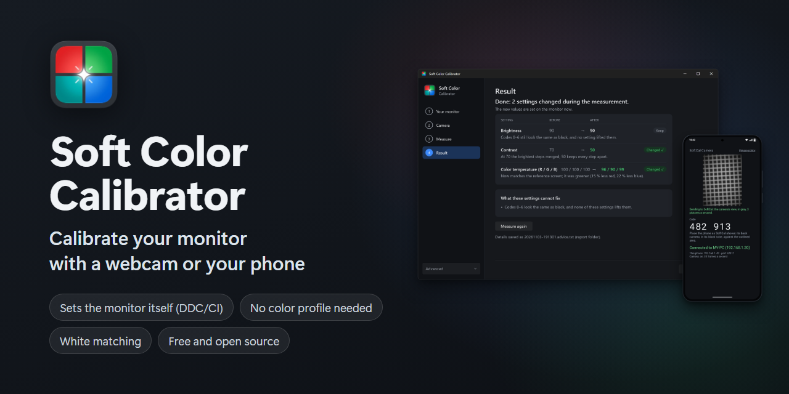
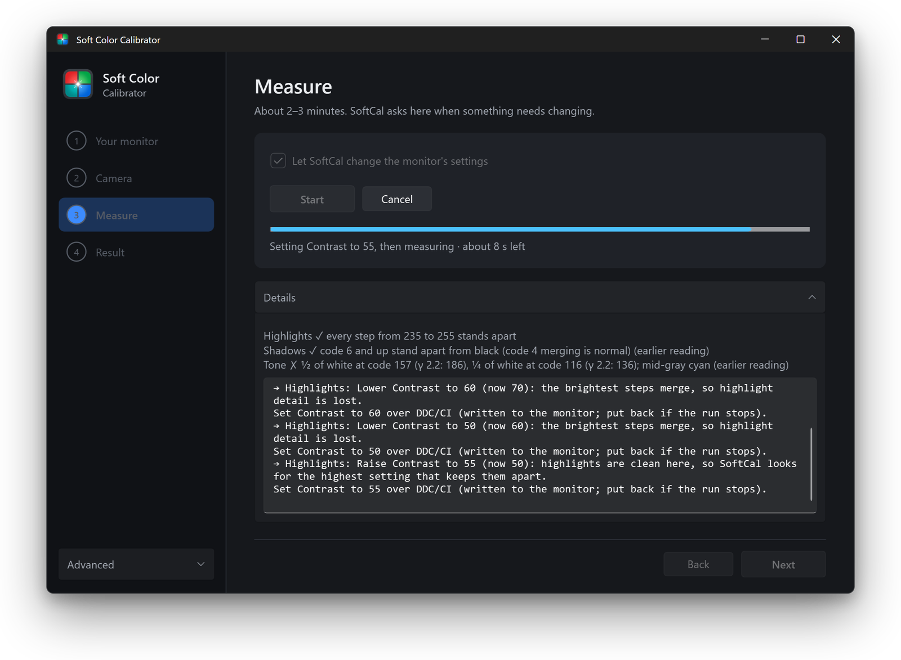
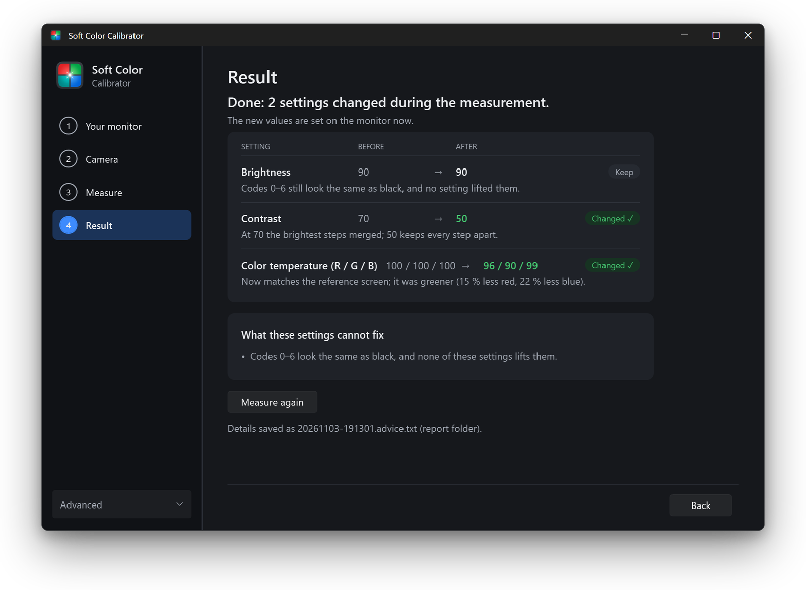
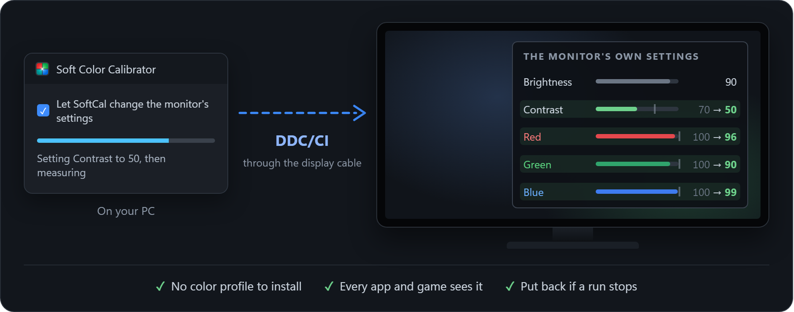
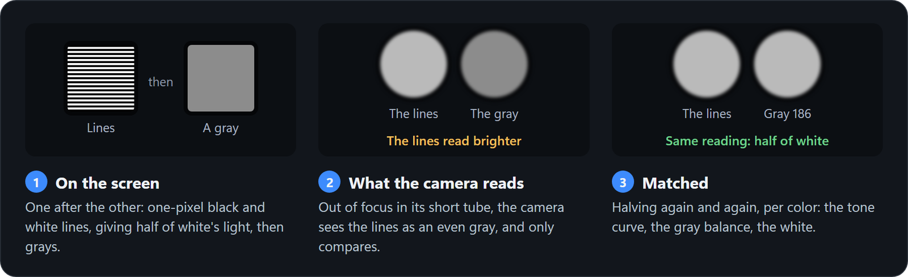
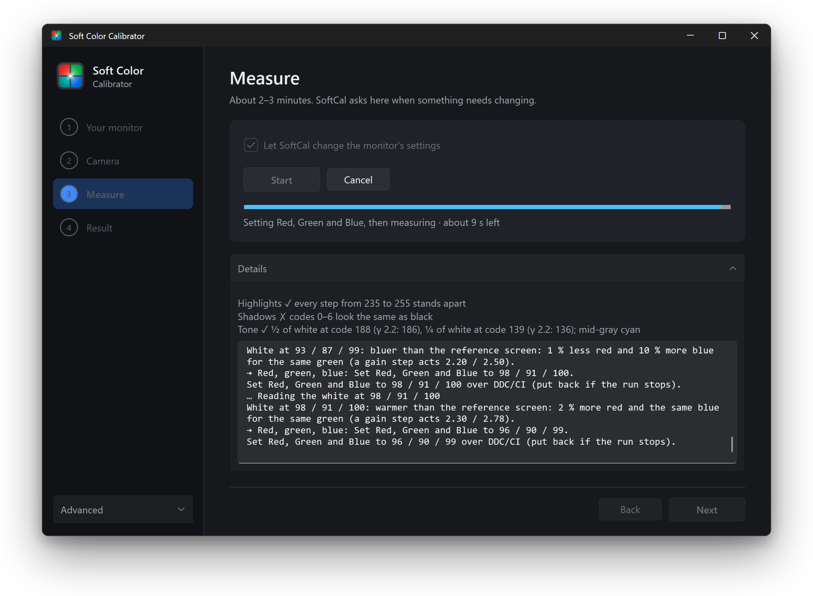
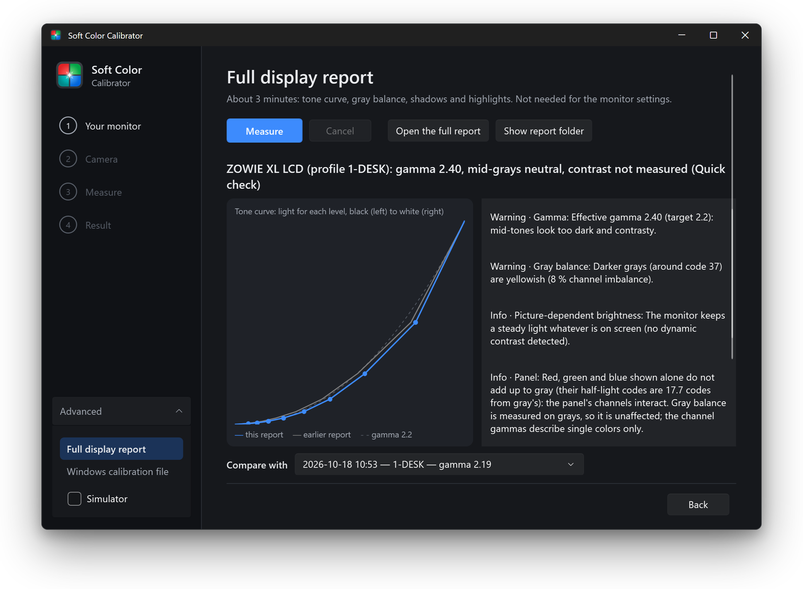
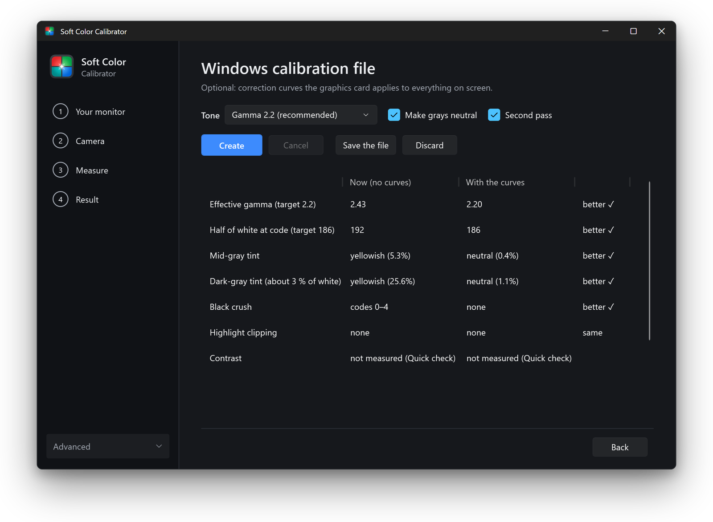
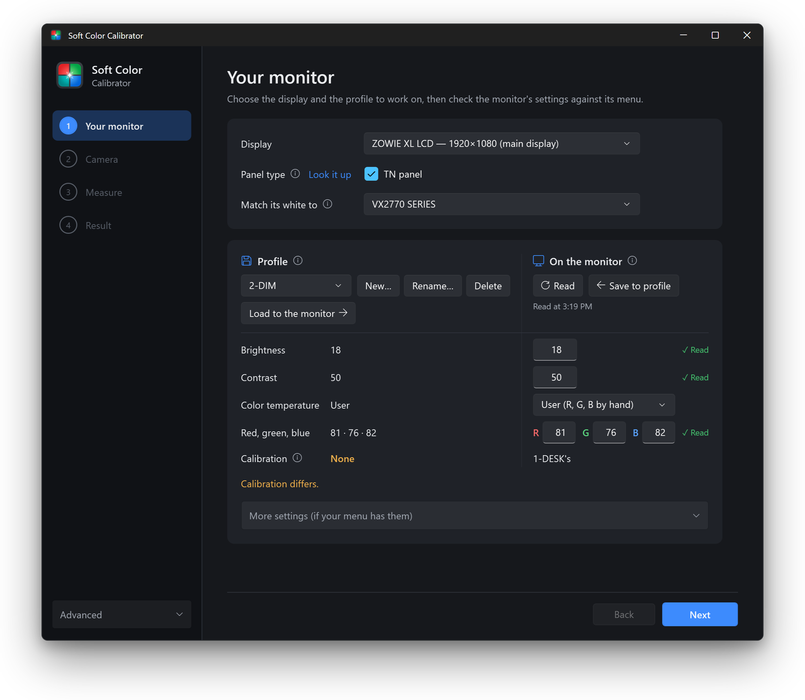
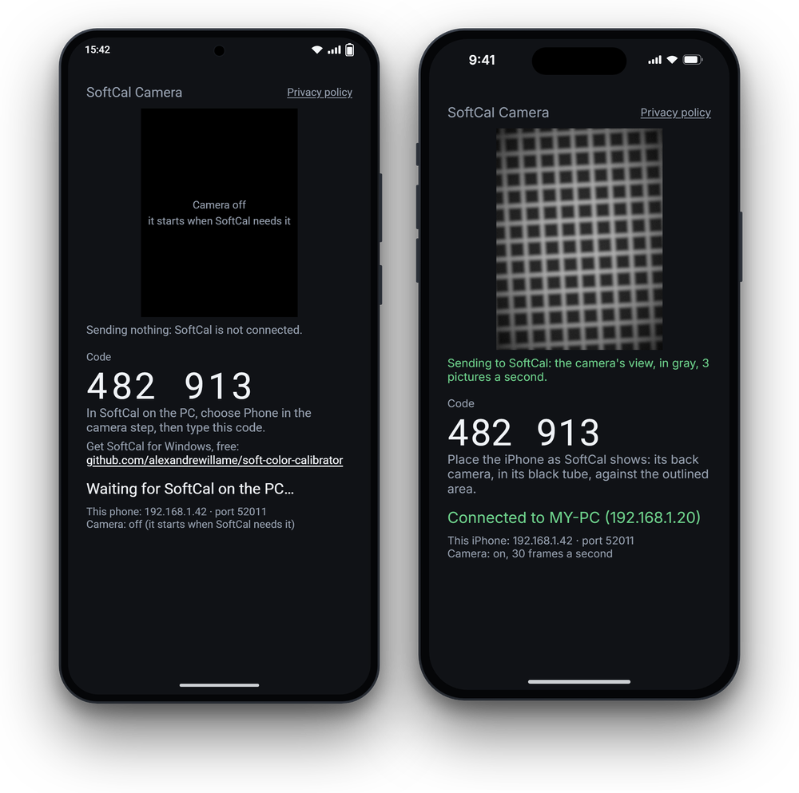

<p align="center">
  
</p>

<p align="center">
  <a href="https://github.com/alexandrewillame/soft-color-calibrator/releases/latest"></a>
  <a href="https://github.com/alexandrewillame/soft-color-calibrator/actions/workflows/windows.yml"></a>
  
  <a href="LICENSE"></a>
</p>

# Soft Color Calibrator

**Calibrate your monitor with a camera you already own: your smartphone or a USB webcam.** Soft Color Calibrator is a
free Windows app that measures your monitor, then **changes the monitor's own brightness, contrast and red, green,
blue, directly from the app**, over DDC/CI. No color profile to install: the monitor itself is corrected. It also
matches your monitor's white to another screen. Your phone measures with **SoftCal Camera**, its companion app.

**[Download for Windows](https://github.com/alexandrewillame/soft-color-calibrator/releases/latest)**

<table>
  <tr>
    <td width="50%"><br><b>Measure:</b> SoftCal sets each value on the monitor itself, then measures again.</td>
    <td width="50%"><br><b>Result:</b> the new values are on the monitor, every one with the reason.</td>
  </tr>
</table>

## It sets your monitor directly

<p align="center"></p>

SoftCal changes the monitor's own **Brightness**, **Contrast** and **Red, Green, Blue** over DDC/CI, the control
channel in your display cable, as the monitor's buttons would. The correction lives in the monitor: no color profile or
graphics-card curves to keep loaded, so every app and game sees it. Each value is measured again after it is set,
and everything SoftCal sets is put back if a run stops. On a monitor without DDC/CI, or with **Let SoftCal change the
monitor's settings** turned off, SoftCal gives each value to set in the monitor's menu instead.

## Features

- **Sets your monitor directly:** brightness, contrast and red, green, blue changed in the monitor itself, from the
  app, over DDC/CI. No color profile needed. One change at a time, each checked by a new measurement; without DDC/CI,
  each value is given for the monitor's menu.
- **White matching:** your monitor's white made the same as another screen's on the same PC, SoftCal setting red,
  green and blue until they match.
- **Display report:** tone curve and gamma, gray balance, crushed blacks, clipped whites, before/after comparisons.
- **Windows calibration file (optional):** for what the monitor's settings cannot fix, an ICC profile with calibration
  curves, created, checked by measuring, and kept loaded.
- **Profiles:** settings for day, night or games, loaded back onto the monitor over DDC/CI with one button.
- **Webcam or phone:** a USB webcam, or SoftCal Camera on Android, measuring from the sensor's raw data when the phone
  offers it. iPhone and iPad: coming soon.
- **Safe and private:** everything SoftCal changes is recorded and put back, even if it crashes. No account, no
  telemetry.

## How it works
A camera is not a colorimeter: its own colors and tone curve are unknown. So SoftCal never asks it *what* it sees,
only **which of two things is brighter**. It shows fine black and white lines whose light is known, then grays, and
finds the gray the camera cannot tell from the lines: the camera's own response cancels out. On the development
monitors, repeated runs agree to about a tenth of a code value, and gamma to within 0.02.

<p align="center"></p>

1. **Your monitor:** choose it, and the screen whose white it should match.
2. **Camera:** rest the camera on the screen in a short black paper tube. A live view shows when it is straight.
3. **Measure:** about 2 to 3 minutes. SoftCal sets each value on the monitor over DDC/CI and measures again, or asks
   you to change it in the menu.
4. **Result:** every setting before and after, with the reason; the new values are already on the monitor.

<details>
<summary><b>More screenshots</b></summary>
<br>
<table>
  <tr>
    <td width="50%"><br><b>White matching:</b> SoftCal sets red, green and blue until the white matches another screen.</td>
    <td width="50%"><br><b>Full display report,</b> compared with an earlier one.</td>
  </tr>
  <tr>
    <td><br><b>Windows calibration file:</b> the display with and without the curves.</td>
    <td><br><b>Your monitor:</b> its settings read over DDC/CI, kept in profiles, loaded back with one button.</td>
  </tr>
</table>
<p align="center"></p>
<sub>The report and the monitor page come from a real monitor; the other screens from SoftCal's simulator (Advanced ›
Simulator), which lets you try the app without a camera, SoftCal setting its demo monitor over DDC/CI included. The
phone screens are drawn from SoftCal Camera's layout.</sub>
</details>

## What you need

- **Windows 11** (22H2 or later), and a second screen while measuring: SoftCal's window moves off the measured one.
- **A camera:** a USB webcam that lets apps set its exposure (a Logitech C920e works well), or an Android phone or
  tablet (Android 9 or later) on the same Wi-Fi as the PC.
- A short tube of black paper around the camera, and something to hold it against the screen, like a stack of books.
- **DDC/CI** on the monitor, so SoftCal can set its values itself: most external monitors have it, some need it turned
  on in their menu. Without it, SoftCal gives each value for the monitor's menu.

## Install

1. Download `SoftColorCalibrator-<version>-win-x64.zip` from the
   [latest release](https://github.com/alexandrewillame/soft-color-calibrator/releases/latest) and extract it to a
   folder where it will stay: once a calibration is installed, Windows starts SoftCal's loader from there.
2. Run `SoftColorCalibrator.exe`. If Windows says it protected your PC: **More info**, then **Run anyway** (the app
   is not signed with a paid certificate; its source is all here). Nothing else to install.
3. **To measure with a phone:** install `SoftCalCamera-<version>.apk` from the same release (Google Play and the App
   Store are coming soon), open it, and in SoftCal choose **Phone** in the Camera step and type the code it shows.
   [More about the phone link](docs/phone-link.md).

## Limits

- **Relative, not absolute, color:** the white is matched to a reference screen; SoftCal cannot say it is exactly
  6500 K. Choose a reference you trust (a factory-calibrated laptop, or a monitor in its sRGB mode).
- Deep shadows and contrast are limited by the camera's sensitivity.
- SDR only: HDR is switched off while measuring and put back afterwards.
- TN panels change with the viewing angle: rest the tube flat; SoftCal checks that the camera is straight.
- Keep the room light as it is during a run.

## Privacy

No account, no ads, no telemetry. Measurements, reports and profiles stay on your PC; SoftCal Camera talks only to
SoftCal on your local network, while you use it. [Privacy policy](https://alexandrewillame.github.io/soft-color-calibrator/privacy.html).

## Build from source

With the [.NET 10 SDK](https://dotnet.microsoft.com/download) (pinned in `global.json`), no Visual Studio needed:

```bash
dotnet build SoftColorCalibrator.slnx
```

```bash
dotnet test
```

[CONTRIBUTING.md](CONTRIBUTING.md) covers the hardware tests, the phone apps and how the code is written; the
[development log](docs/development-log.md) how it was designed and verified.

## License

Copyright © 2026 Alexandre Willame. Soft Color Calibrator and SoftCal Camera are free software under the
[GNU General Public License v3](LICENSE): you may use, study, share and change them; versions you distribute must stay
under the same license, with their source. They come with no warranty.
